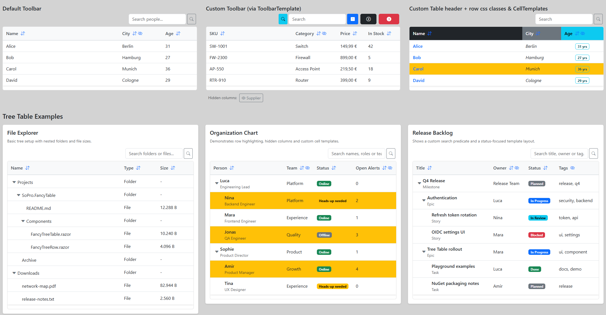

[](https://github.com/SolidProgramming/SoPro.FancyTable/actions/workflows/dotnet-build.yml) <br/>
[](https://github.com/SolidProgramming/SoPro.FancyTable/actions/workflows/codeql.yml)

## [Interactive Playground](https://playground.solidprogramming.dev/)

# SoPro.FancyTable

https://www.nuget.org/packages/SoPro.FancyTable



## Overview

`FancyTable` is a reusable Blazor component that provides an interactive table experience with built-in support for searching, sorting, pagination, and column visibility management. It's designed to work with any data type through its generic `TItem` parameter.

`FancyTreeTable` extends the same column model and interaction patterns to hierarchical datasets, so parent/child structures can be displayed with expand/collapse behavior.

## Features

### Search
- Default search across all columns where `Searchable = true`
- Custom search predicates via `SearchPredicate`
- Debounced input with immediate apply on `Enter`
- Flexible search text extraction per column via `SearchTextSelector`

### Sorting
- Column sorting with ascending / descending toggle
- Sort indicators in the header
- Custom sort values via `SortValueSelector`
- Tree-aware sorting that only reorders siblings within the same parent level

### Column visibility
- Hideable columns via `Hideable`
- Hidden-column restore buttons below the table

### Column filters
- Opt-in per column via `Filterable`; a funnel icon in the header opens a popup with an operator and a value
- Eight case-insensitive text operators: `Equals`, `NotEquals`, `Contains`, `NotContains`, `StartsWith`, `EndsWith`, `IsEmpty`, `IsNotEmpty`
- Date and number columns via `FilterType`: a native date picker (`<input type="date">`) or number input, and the operators `Equals`, `NotEquals`, `GreaterThan`, `GreaterThanOrEqual`, `LessThan`, `LessThanOrEqual`, `Between` (two inputs, both bounds inclusive), `IsEmpty`, `IsNotEmpty`
- Per-column operator selection via `FilterOperators`, e.g. only `Equals` and `NotEquals` for an id column; filters with an operator the column does not offer are ignored
- Filters combine with AND across columns and with the active search
- Filtered text comes from `SearchTextSelector`, falling back to `ValueSelector`; date and number columns compare the `ValueSelector` value itself
- `Equals` and `NotEquals` compare trimmed text; the other operators use the value as typed
- `IsEmpty` and `IsNotEmpty` take no value
- Filters apply explicitly (Apply button or Enter); Esc or a click outside discards the draft
- Every filter change resets the table to page 1
- A hidden column keeps its filter; its restore button shows a funnel icon
- `ColumnFiltersChanged` delivers the complete list in column definition order
- A `Filterable` column needs a `ValueSelector` or `SearchTextSelector`; `CellTemplate`-only columns have empty filter text
- Operator values are stable integers; use `JsonStringEnumConverter` if you prefer names in persisted JSON
- Requires a browser with the HTML Popover API (Baseline since 2024)
- Host-owned persistence through `InitialColumnFilters` and `ColumnFiltersChanged`

### Column layout
- Opt-in resizing and reordering for flat and tree tables
- Content-based natural widths with optional `Width`, `MinWidth`, and `MaxWidth`
- Mouse, touch, pen, and keyboard interaction without third-party JavaScript dependencies
- Persistable order and widths through `InitialColumnLayout` and `ColumnLayoutChanged`
- Click-to-expand ellipsis for constrained values rendered by `ValueSelector`

### Pagination
- Optional local/client-side pagination for flat and tree tables
- Bindable `CurrentPage` and `PageSize` state
- Default footer pager with optional page-size selector
- Custom pagination, summary, and page-size templates via `FancyPaginationContext<TItem>`

### Server mode
- Optional `ItemsProvider` for flat and tree tables: search, column filters, sorting and paging are executed by your data source (database, API) and only the current page is loaded
- Outdated requests are cancelled, a loading state is shown while a page loads

### Localization
- Built-in texts follow the UI culture (`CultureInfo.CurrentUICulture`); English and German are bundled
- Centralized UI texts via `FancyTableTexts` (`Current`, `ForCulture`, fixed English `Default`)
- Optional per-table text overrides through the `Texts` parameter

### Hierarchical data
- Expand/collapse in `FancyTreeTable`
- Expand all / collapse all via `TreeActionsTemplate` or `@ref`
- Shared column model across flat and tree tables
- Search keeps matching nodes and their ancestors visible
- Configurable child lookup via `ChildItemsSelector`
- Optional `HasChildrenSelector` optimization
- Null child entries are ignored during tree construction

### Customization
- Custom toolbar via `ToolbarTemplate`
- Custom cell content via `CellTemplate`
- Full-row customization through a unified `RowTemplate`
- Conditional row replacement via `RowTemplateSelector`
- Unified row context for flat and tree tables via `FancyRowContext<TItem>`
- Optional row attributes via `RowAttributesSelector`
- Optional leading-content hook for the first cell via `RowLeadingContentTemplate`
- Row classes via `RowClassSelector`
- Header and cell styling via `HeaderClass` and `CellClass`
- Wrapper layout classes for toolbar, tree actions, page size, and pagination containers

#### Top bar layout

The top bar (`.fancy-table-topbar`) holds the page-size selector (`.fancy-page-size`) and the toolbar (`.fancy-toolbar`). The default layout (flex row, wrapped, items spaced apart, toolbar pushed right) is set in the component CSS rather than as Bootstrap utility classes in the markup. Any utility class you pass via `TopBarClass`, `PageSizeContainerClass` or `ToolbarContainerClass` therefore overrides it, for example to put both side by side on the left:

```razor
<FancyTable TItem="Person"
            Items="people"
            Columns="columns"
            PaginationEnabled="true"
            ShowPageSizeSelector="true"
            TopBarClass="justify-content-start"
            PageSizeContainerClass="d-inline-flex"
            ToolbarContainerClass="d-inline-flex ms-0 gap-2" />
```

To style them with your own CSS, target the classes from a parent with `::deep`, e.g. `.my-table ::deep .fancy-toolbar { ... }`.

## Parameters

| Parameter | Type | Description |
|-----------|------|-------------|
| `Items` | `IReadOnlyList<TItem>` | The data items to display in the table (required unless `ItemsProvider` is set) |
| `ItemsProvider` | `FancyItemsProvider<TItem>?` | Loads one page at a time (server mode); mutually exclusive with `Items`, see [Server Mode](#server-mode) |
| `LoadingTemplate` | `RenderFragment?` | Rendered above the table while the `ItemsProvider` is loading |
| `Columns` | `IReadOnlyList<FancyColumn<TItem>>` | Column configuration (required) |
| `Texts` | `FancyTableTexts?` | Centralized overrides for built-in UI labels and summary text |
| `ToolbarTemplate` | `RenderFragment?` | Custom toolbar content; replaces the default search bar |
| `SearchPredicate` | `Func<TItem, string, bool>?` | Custom search logic; overrides default column-based search |
| `RowClassSelector` | `Func<TItem, string?>?` | Returns CSS class(es) for each row |
| `RowAttributesSelector` | `Func<FancyRowContext<TItem>, IReadOnlyDictionary<string, object?>?>?` | Supplies additional attributes for the rendered `<tr>` |
| `RowLeadingContentTemplate` | `RenderFragment<FancyRowContext<TItem>>?` | Renders extra content at the start of the first visible cell |
| `RowTemplate` | `RenderFragment<FancyRowContext<TItem>>?` | Renders a complete custom table row (`<tr>...</tr>`) |
| `RowTemplateSelector` | `Func<FancyRowContext<TItem>, bool>?` | Chooses which rows use `RowTemplate`; if omitted, `RowTemplate` applies to every row |
| `PaginationEnabled` | `bool` | Enables local pagination when `PageSize > 0` |
| `PageSize` | `int` | Active page size; values `<= 0` effectively disable pagination |
| `PageSizeChanged` | `EventCallback<int>` | Raised when the page size changes |
| `CurrentPage` | `int` | Active 1-based page index |
| `CurrentPageChanged` | `EventCallback<int>` | Raised when the page changes |
| `PageSizeOptions` | `IReadOnlyList<int>?` | Available page-size options for the default selector |
| `ShowPaginationSummary` | `bool` | Shows the default or custom summary area in the footer |
| `ShowPageSizeSelector` | `bool` | Shows the default or custom page-size UI above the table |
| `PaginationSummaryTemplate` | `RenderFragment<FancyPaginationContext<TItem>>?` | Custom summary content for the default footer |
| `PaginationTemplate` | `RenderFragment<FancyPaginationContext<TItem>>?` | Replaces the visible footer pager area |
| `PageSizeTemplate` | `RenderFragment<FancyPaginationContext<TItem>>?` | Replaces the page-size selector area above the table |
| `TopBarClass` | `string?` | Additional CSS classes for the top bar wrapper (`.fancy-table-topbar`); utility classes override the default layout |
| `ToolbarContainerClass` | `string?` | Additional CSS classes for the toolbar/search container (`.fancy-toolbar`); utility classes override the default layout |
| `PageSizeContainerClass` | `string?` | Additional CSS classes for the page-size wrapper (`.fancy-page-size`) |
| `PaginationContainerClass` | `string?` | Additional CSS classes for the pagination footer wrapper |
| `PaginationSummaryClass` | `string?` | Additional CSS classes for the pagination summary wrapper |
| `EnableColumnResizing` | `bool` | Enables resize handles; disabled by default |
| `EnableColumnReordering` | `bool` | Enables reorder handles; disabled by default |
| `InitialColumnLayout` | `IReadOnlyList<FancyColumnLayout>?` | Initial order and optional widths, applied once per component instance |
| `ColumnLayoutChanged` | `EventCallback<IReadOnlyList<FancyColumnLayout>>` | Raised with the complete normalized layout after a resize or reorder |
| `InitialColumnFilters` | `IReadOnlyList<FancyColumnFilter>?` | Initial column filters, applied once per component instance; entries for unknown or non-`Filterable` columns are ignored |
| `ColumnFiltersChanged` | `EventCallback<IReadOnlyList<FancyColumnFilter>>` | Raised with the complete list of active filters after a filter is applied or cleared |

## Tree Table Parameters

`FancyTreeTable<TItem>` supports the same parameters as `FancyTable<TItem>` and adds the following:

| Parameter | Type | Description |
|-----------|------|-------------|
| `ChildItemsSelector` | `Func<TItem, IEnumerable<TItem>?>` | Returns the child items for a given node (required) |
| `HasChildrenSelector` | `Func<TItem, bool>?` | Optional optimization to indicate whether a node should render an expand/collapse toggle |
| `InitiallyExpandedSelector` | `Func<TItem, bool>?` | Optional initial state provider used to seed each node's expand/collapse state the first time it appears |
| `Texts` | `FancyTableTexts?` | Centralized overrides for built-in UI labels and summary text |
| `TreeActionsTemplate` | `RenderFragment<FancyTreeTableContext<TItem>>?` | Renders custom tree-level actions such as expand/collapse all |
| `TreeActionsContainerClass` | `string?` | Additional CSS classes for the tree actions wrapper |

## Row Context

`FancyRowContext<TItem>` is passed into `RowTemplate`, `RowTemplateSelector`, `RowAttributesSelector`, and `RowLeadingContentTemplate`.

| Property | Type | Description |
|----------|------|-------------|
| `Item` | `TItem` | The current row item |
| `Columns` | `IReadOnlyList<FancyColumn<TItem>>` | Currently visible columns |
| `VisibleColumnCount` | `int` | Count of visible columns, useful for `colspan` rows |
| `IsTreeNode` | `bool` | Indicates whether the row comes from `FancyTreeTable` |
| `Depth` | `int` | Tree depth for tree rows; `0` for flat tables |
| `HasChildren` | `bool` | Whether the tree row has children |
| `IsExpanded` | `bool` | Whether the tree row is currently expanded |
| `CanToggle` | `bool` | Convenience flag for toggle availability |
| `ToggleNode` | `EventCallback` | Expands or collapses the current tree node |
| `ExpandLabel` | `string` | Accessible label for collapsed nodes |
| `CollapseLabel` | `string` | Accessible label for expanded nodes |

For flat tables, tree-specific values are neutral: `IsTreeNode = false`, `Depth = 0`, `HasChildren = false`, and `ToggleNode` is empty.

## Tree Table Context

`FancyTreeTableContext<TItem>` is passed into `TreeActionsTemplate`.

| Property | Type | Description |
|----------|------|-------------|
| `RootItemCount` | `int` | Number of root items in the tree |
| `VisibleNodeCount` | `int` | Number of currently visible nodes after search and expand/collapse state |
| `ExpandedNodeCount` | `int` | Number of currently expanded nodes that have children |
| `HasExpandableNodes` | `bool` | Whether the tree contains any expandable nodes |
| `CanExpandAny` | `bool` | Whether at least one expandable node is currently collapsed |
| `CanCollapseAny` | `bool` | Whether at least one expandable node is currently expanded |
| `ExpandAll()` | `Task` | Expands the entire tree across all levels |
| `CollapseAll()` | `Task` | Collapses the entire tree across all levels |

`FancyTreeTable<TItem>` also exposes imperative methods for `@ref` usage:

- `ExpandAllAsync()`
- `CollapseAllAsync()`

## Pagination Context

`FancyPaginationContext<TItem>` is passed into `PaginationSummaryTemplate`, `PaginationTemplate`, and `PageSizeTemplate`.

| Property | Type | Description |
|----------|------|-------------|
| `CurrentPage` | `int` | Active 1-based page index |
| `PageSize` | `int` | Active page size |
| `TotalItemCount` | `int` | Unfiltered item count |
| `FilteredItemCount` | `int` | Count after search/filtering |
| `PageCount` | `int` | Number of available pages |
| `StartItemIndex` | `int` | 1-based start index of the current page |
| `EndItemIndex` | `int` | 1-based end index of the current page |
| `HasPreviousPage` | `bool` | Whether a previous page exists |
| `HasNextPage` | `bool` | Whether a next page exists |
| `GoToPage(int)` | `Task` | Jumps to a specific page |
| `GoToPreviousPage()` | `Task` | Moves to the previous page |
| `GoToNextPage()` | `Task` | Moves to the next page |
| `SetPageSize(int)` | `Task` | Updates the page size and resets to page 1 |

## Localization

Without a `Texts` parameter, tables use `FancyTableTexts.Current`: the built-in texts for the current UI culture (`CultureInfo.CurrentUICulture`). English and German are bundled (`FancyTable.resx`, `FancyTable.en.resx`, `FancyTable.de.resx`). Regional cultures use their parent language (`de-AT` → German), and every other culture falls back to English.

> **Behavior change:** apps whose UI culture is German now show German table texts automatically. This includes Blazor Server apps without request localization that run on a server or container with a German OS culture. To keep the previous English texts, pass `Texts="FancyTableTexts.Default"`.

Where the UI culture comes from depends on the hosting model:

- **Blazor Server / SSR:** the request culture set by `UseRequestLocalization` (see below). Without request localization, the server process's OS culture applies.
- **Blazor WebAssembly:** the browser language by default. To switch languages, set the culture before the app starts and reload the page, because satellite assemblies are loaded for the startup culture.
- **Trimmed globalization:** with `<InvariantGlobalization>true</InvariantGlobalization>`, or with `<SatelliteResourceLanguages>` excluding `de`, the German texts are not available and the tables show English.

Set the UI culture the usual ASP.NET Core way, for example with request localization:

```csharp
app.UseRequestLocalization(new RequestLocalizationOptions()
    .SetDefaultCulture("en")
    .AddSupportedCultures("en", "de")
    .AddSupportedUICultures("en", "de"));
```

Column titles (`FancyColumn.Title`) and your own cell content are app content and are not translated by the library. Localize them in your app, for example with `IStringLocalizer`, and build the column definitions at render time when the language can change.

`FancyTableTexts` members:

- `Current` — texts for the current UI culture (cached per culture)
- `ForCulture(CultureInfo culture)` — texts for a specific culture
- `Default` — the fixed English texts, independent of the culture

To override single texts and keep the rest localized, build the override at render time from `Current` (not in a `static` field, which would freeze the culture that was active at startup):

```razor
<FancyTable TItem="Person" Items="people" Columns="columns" Texts="PeopleTexts" />

@code {
    private FancyTableTexts PeopleTexts => FancyTableTexts.Current with
    {
        SearchPlaceholder = "Search people"
    };
}
```

The column filter popup adds these keys (English defaults): `FilterColumnFormat` ("Filter column {0}"), `FilterValuePlaceholder`, `ApplyFilterLabel`, `ClearFilterLabel`, and one label per operator: `FilterOperatorEqualsLabel`, `FilterOperatorNotEqualsLabel`, `FilterOperatorContainsLabel`, `FilterOperatorNotContainsLabel`, `FilterOperatorStartsWithLabel`, `FilterOperatorEndsWithLabel`, `FilterOperatorIsEmptyLabel`, `FilterOperatorIsNotEmptyLabel`, `FilterOperatorGreaterThanLabel`, `FilterOperatorGreaterThanOrEqualLabel`, `FilterOperatorLessThanLabel`, `FilterOperatorLessThanOrEqualLabel`, `FilterOperatorBetweenLabel`, and `FilterValueFromLabel` / `FilterValueToLabel` ("From" / "To", the accessible names of the two `Between` inputs).

Accessibility labels for the table header, search and filter popup use these keys (English defaults): `SortColumnFormat` ("Sort column {0}"), `HideColumnFormat` ("Hide column {0}"), `FilteredColumnLabel` ("filtered", read by screen readers on restore buttons of filtered hidden columns), `FilterOperatorLabel` ("Operator") and `ClearSearchLabel` ("Clear search"). The search input and search button reuse `SearchPlaceholder` as their accessible name.

## Column Configuration

Each column is configured using `FancyColumn<TItem>`:

| Property | Type | Description |
|----------|------|-------------|
| `Key` | `string` | Unique identifier for the column |
| `Title` | `string` | Display name shown in the header |
| `Sortable` | `bool` | Whether the column can be sorted |
| `Searchable` | `bool` | Whether the column is included in search (default: `true`) |
| `Hideable` | `bool` | Whether the column can be hidden by the user |
| `Filterable` | `bool` | Whether the header shows a filter popup for this column (default: `false`) |
| `FilterOperators` | `IReadOnlyList<FancyColumnFilterOperator>?` | Operators offered in the filter popup of this column, in the given order; operators not valid for `FilterType` are dropped; `null` or empty offers all operators of the `FilterType` |
| `FilterType` | `FancyColumnFilterType` | `Text` (default), `Date` or `Number`; selects the filter input and the offered operators |
| `Resizable` | `bool` | Whether the column can be resized when resizing is enabled (default: `true`) |
| `Reorderable` | `bool` | Whether the column can be reordered when reordering is enabled (default: `true`) |
| `Width` | `double?` | Initial width in pixels; natural content width is used when omitted |
| `MinWidth` | `double?` | Optional minimum display and resize width in pixels; without `Width`, `MinWidth` and `MaxWidth` the column has no minimum width (`auto`) |
| `MaxWidth` | `double?` | Optional maximum automatic and resize width in pixels |
| `HeaderClass` | `string?` | CSS class applied to the header cell |
| `CellClass` | `string?` | CSS class applied to data cells |
| `ValueSelector` | `Func<TItem, object?>?` | Extracts the value to display for each row |
| `SortValueSelector` | `Func<TItem, IComparable?>?` | Extracts the value used for sorting (falls back to `ValueSelector`) |
| `SearchTextSelector` | `Func<TItem, string?>?` | Extracts the text used for searching (falls back to `ValueSelector?.ToString()`) |
| `CellTemplate` | `RenderFragment<TItem>?` | Custom Blazor template to render cell content |

### Resizing and reordering

```razor
<FancyTable TItem="PersonRow"
            Items="people"
            Columns="PeopleColumns"
            EnableColumnResizing="true"
            EnableColumnReordering="true"
            InitialColumnLayout="SavedLayout"
            ColumnLayoutChanged="SaveLayout" />

@code {
    private IReadOnlyList<FancyColumnLayout>? SavedLayout;

    private void SaveLayout(IReadOnlyList<FancyColumnLayout> layout) =>
        SavedLayout = layout;
}
```

Columns without `Width` or `MaxWidth` initially follow the currently rendered content. A `MaxWidth`-constrained `ValueSelector` cell uses an ellipsis when necessary; click it, or focus it and press `Enter`/`Space`, to toggle the full value. Custom `CellTemplate` content retains full control over its own overflow behavior.

The first declared column of `FancyTreeTable` remains visible and fixed at the left while reordering is enabled. Non-reorderable columns act as boundaries that other columns cannot cross. Hidden columns retain their saved position and width.

### Column filters

Mark columns with `Filterable = true`. The host persists the filters; the component stores nothing itself. This example uses `localStorage` through `JSRuntime`:

```razor
@inject IJSRuntime JS
@using System.Text.Json

@if (filtersLoaded)
{
    <FancyTable TItem="PersonRow"
                Items="People"
                Columns="PeopleColumns"
                InitialColumnFilters="SavedFilters"
                ColumnFiltersChanged="SaveFiltersAsync" />
}

@code {
    private IReadOnlyList<FancyColumnFilter>? SavedFilters;
    private bool filtersLoaded;

    protected override async Task OnAfterRenderAsync(bool firstRender)
    {
        if (!firstRender)
        {
            return;
        }

        string? json = await JS.InvokeAsync<string?>("localStorage.getItem", "people-filters");
        SavedFilters = json is null ? null : JsonSerializer.Deserialize<List<FancyColumnFilter>>(json);
        filtersLoaded = true;
        StateHasChanged();
    }

    private async Task SaveFiltersAsync(IReadOnlyList<FancyColumnFilter> filters) =>
        await JS.InvokeVoidAsync("localStorage.setItem", "people-filters", JsonSerializer.Serialize(filters));
}
```

To restrict the operators of a column, list them in `FilterOperators`. The popup offers them in the given order and preselects `Contains` if it is offered, otherwise the first one. Initial or applied filters with an operator the column does not offer are ignored, which is useful in server mode when the backend cannot answer every operator for a column:

```csharp
new FancyColumn<PersonRow>
{
    Key = "id",
    Title = "Id",
    ValueSelector = p => p.Id,
    Filterable = true,
    FilterOperators = [FancyColumnFilterOperator.Equals, FancyColumnFilterOperator.NotEquals]
}
```

### Date and number filters

Set `FilterType` to get a date picker or a number input and comparison operators instead of the text operators. The column's `ValueSelector` must return the value itself, not formatted text:

```csharp
new FancyColumn<PersonRow>
{
    Key = "born",
    Title = "Born",
    ValueSelector = p => p.Born,          // DateTime, DateTimeOffset or DateOnly (nullable is fine)
    Filterable = true,
    FilterType = FancyColumnFilterType.Date
}
```

- `Date` accepts `DateTime`, `DateTimeOffset` and `DateOnly` values and compares the day only; the time is ignored, and a `DateTimeOffset` keeps its own date.
- `Number` accepts all built-in numeric types and compares them as `decimal`; `NaN`, infinities and values outside the `decimal` range count as empty.
- `null` and values of other types count as empty: they match `IsEmpty` and `NotEquals` and nothing else.
- `Between` uses `FancyColumnFilter.ValueTo` as its second value (both bounds inclusive, swapped if given in reverse order); for every other operator `ValueTo` is `null`.
- Filter values are culture-invariant strings: `yyyy-MM-dd` for dates and `.` as the decimal separator for numbers (what the browser inputs produce). Initial or applied filters with a value in another format are ignored. Server-mode providers receive these strings in `request.ColumnFilters` and can parse them with `CultureInfo.InvariantCulture`.
- How the date picker looks and how the date is displayed in the input depend on the browser and its language.

`InitialColumnFilters` is read once, on the table's first render, so load persisted filters before rendering the table. `localStorage` is only available after the first render (it is not during prerendering), which is why the example renders the table once `filtersLoaded` is set.

## Setup

To use `SoPro.FancyTable` in your Blazor application, include Bootstrap CSS and Bootstrap Icons in your app (`App.razor` / host page):

```html
<link rel="stylesheet" href="https://cdn.jsdelivr.net/npm/bootstrap@5.3.7/dist/css/bootstrap.min.css" />
<link rel="stylesheet" href="https://cdn.jsdelivr.net/npm/bootstrap-icons@1.11.3/font/bootstrap-icons.min.css" />
```

Add `SoPro.FancyTable.Components` to your `_Imports.razor` and rebuild the project:

```razor
@using SoPro.FancyTable.Components
```

## Usage Example

This example covers:
- default toolbar
- custom toolbar (`ToolbarTemplate`)
- custom cell template
- row-level classes (`RowClassSelector`)
- conditional custom rows (`RowTemplate` + `RowTemplateSelector`)
- custom row callbacks

```csharp
@page "/fancy-table-demo"

<div class="d-flex">
    <div class="p-3 col">
        <h5>Default Toolbar</h5>
        <FancyTable TItem="PersonRow"
                    Items="PeopleRows"
                    Columns="PeopleColumns"
                    PaginationEnabled="true"
                    PageSize="10"
                    ShowPageSizeSelector="true"
                    Texts="DemoTexts" />
    </div>

    <div class="p-3 col">
        <h5>Custom Toolbar</h5>
        <FancyTable TItem="ProductRow"
                    Items="ProductRows"
                    Columns="ProductColumns">
            <ToolbarTemplate>
                <div class="d-flex">
                    <button class="btn btn-sm btn-info mx-1">
                        <i class="bi bi-search"></i>
                    </button>
                    <input class="form-control form-control-md" placeholder="Custom search UI" />
                </div>
            </ToolbarTemplate>
        </FancyTable>
    </div>

    <div class="p-3 col">
        <h5>Conditional custom rows</h5>
        <FancyTable TItem="PersonRow"
                    Items="PeopleRows"
                    Columns="StyledPeopleColumns"
                    RowClassSelector="GetPersonRowClass"
                    RowTemplate="PersonHighlightRow"
                    RowTemplateSelector="context => context.Item.Age >= 35" />
    </div>
</div>

@code {
    private static readonly FancyTableTexts DemoTexts = FancyTableTexts.Default with
    {
        SearchPlaceholder = "Search name or city..."
    };

    private IReadOnlyList<PersonRow> PeopleRows =
    [
        new("Alice", "Berlin", 31),
        new("Bob", "Hamburg", 27),
        new("Carol", "Munich", 36),
        new("David", "Cologne", 29)
    ];

    private IReadOnlyList<FancyColumn<PersonRow>> PeopleColumns =>
    [
        new FancyColumn<PersonRow>
        {
            Key = "name",
            Title = "Name",
            Sortable = true,
            Searchable = true,
            ValueSelector = person => person.Name,
            SortValueSelector = person => person.Name
        },
        new FancyColumn<PersonRow>
        {
            Key = "city",
            Title = "City",
            Sortable = true,
            Searchable = true,
            Hideable = true,
            ValueSelector = person => person.City,
            SortValueSelector = person => person.City
        },
        new FancyColumn<PersonRow>
        {
            Key = "age",
            Title = "Age",
            Sortable = true,
            Searchable = false,
            ValueSelector = person => person.Age,
            SortValueSelector = person => person.Age
        }
    ];

    private IReadOnlyList<ProductRow> ProductRows =
    [
        new("SW-1001", "Switch", 149.99m, 42, "NetWare Ltd"),
        new("FW-2300", "Firewall", 899.00m, 5, "SecureCore AG")
    ];

    private IReadOnlyList<FancyColumn<ProductRow>> ProductColumns =>
    [
        new FancyColumn<ProductRow>
        {
            Key = "sku",
            Title = "SKU",
            Sortable = true,
            Searchable = true,
            ValueSelector = product => product.Sku,
            SortValueSelector = product => product.Sku
        },
        new FancyColumn<ProductRow>
        {
            Key = "price",
            Title = "Price",
            Sortable = true,
            Searchable = false,
            ValueSelector = product => product.Price.ToString("C2"),
            SortValueSelector = product => product.Price
        }
    ];

    private IReadOnlyList<FancyColumn<PersonRow>> StyledPeopleColumns =>
    [
        new FancyColumn<PersonRow>
        {
            Key = "styled-name",
            Title = "Name",
            Sortable = true,
            Searchable = true,
            HeaderClass = "text-bg-dark",
            CellClass = "fw-semibold text-primary",
            ValueSelector = person => person.Name,
            SortValueSelector = person => person.Name
        },
        new FancyColumn<PersonRow>
        {
            Key = "styled-age",
            Title = "Age",
            Sortable = true,
            Searchable = false,
            CellTemplate = person => @<span class="badge text-bg-info-subtle border border-info text-info-emphasis">@person.Age yrs</span>
        }
    ];

    private string? GetPersonRowClass(PersonRow person) => person.Age >= 35 ? "bg-warning" : null;

    private RenderFragment<FancyRowContext<PersonRow>> PersonHighlightRow => context => @<tr class="table-warning">
        <td colspan="@context.VisibleColumnCount">
            <strong>@context.Item.Name</strong> is flagged for review from @context.Item.City.
            <button class="btn btn-sm btn-primary ms-2" @onclick="() => OpenPerson(context.Item)">Details</button>
        </td>
    </tr>;

    private void OpenPerson(PersonRow person)
    {
        Console.WriteLine($"Open details for {person.Name}");
    }

    private sealed record PersonRow(string Name, string City, int Age);
    private sealed record ProductRow(string Sku, string Category, decimal Price, int Stock, string Supplier);
}
```

`RowTemplate` renders the full row (`<tr>...</tr>`). If `RowTemplateSelector` is omitted, the custom row template applies to every row.

When pagination is enabled, `FancyTable` paginates after search and sorting. `CurrentPage` and `PageSize` can be bound to keep state stable across parent rerenders.

Wrapper class parameters append to the built-in layout classes, so utility classes such as `d-inline-flex`, `justify-content-end`, or `gap-3` can adjust the layout without replacing templates.

## Tree Table Example

`FancyTreeTable<TItem>` works with nested data while keeping the same column definition style:

```csharp
@page "/fancy-tree-table-demo"

<FancyTreeTable TItem="RuleRow"
                @ref="RuleTable"
                Items="Rules"
                Columns="RuleColumns"
                ChildItemsSelector="row => row.Children"
                HasChildrenSelector="row => row.Children.Count > 0"
                PaginationEnabled="true"
                PageSize="5"
                ShowPageSizeSelector="true"
                TopBarClass="justify-content-end"
                PageSizeContainerClass="me-auto"
                TreeActionsContainerClass="d-inline-flex align-items-center gap-2"
                PaginationContainerClass="justify-content-end"
                TreeActionsTemplate="RuleTreeActions"
                RowTemplate="SectionHeaderTemplate"
                RowTemplateSelector="context => context.Item.IsSectionHeader"
                Texts="RuleTableTexts" />

@code {
    private FancyTreeTable<RuleRow>? RuleTable;

    private static readonly FancyTableTexts RuleTableTexts = FancyTableTexts.Default with
    {
        SearchPlaceholder = "Search rules..."
    };

    private static readonly RuleRow Rule_11_1 = new("11.1", "Allow HTTPS", "TCP", "443", "Any", "Server-A", "Allow", [], false);
    private static readonly RuleRow Rule_11_2 = new("11.2", "Allow DNS", "UDP", "53", "Any", "DNS-1", "Allow", [], false);
    private static readonly RuleRow Rule_11_3 = new("11.3", "Block Telnet", "TCP", "23", "Any", "Any", "Deny", [], false);

    private IReadOnlyList<RuleRow> Rules =
    [
        new("", "Section Header", "", "", "", "", "", [Rule_11_1, Rule_11_2, Rule_11_3], IsSectionHeader: true)
    ];

    private IReadOnlyList<FancyColumn<RuleRow>> RuleColumns =>
    [
        new() { Key = "number", Title = "Rule", ValueSelector = x => x.Number },
        new() { Key = "name", Title = "Name", ValueSelector = x => x.Name },
        new() { Key = "protocol", Title = "Protocol", ValueSelector = x => x.Protocol },
        new() { Key = "port", Title = "Port", ValueSelector = x => x.Port },
        new() { Key = "source", Title = "Source", ValueSelector = x => x.Source },
        new() { Key = "destination", Title = "Destination", ValueSelector = x => x.Destination },
        new() { Key = "action", Title = "Action", ValueSelector = x => x.Action }
    ];

    private RenderFragment<FancyRowContext<RuleRow>> SectionHeaderTemplate => context => @<tr class="table-secondary fw-bold">
        <td colspan="@context.VisibleColumnCount">
            <button type="button"
                    class="btn btn-link btn-sm text-decoration-none p-0 me-2"
                    @onclick="() => context.ToggleNode.InvokeAsync()"
                    aria-label="@(context.IsExpanded ? context.CollapseLabel : context.ExpandLabel)"
                    aria-expanded="@context.IsExpanded">
                <i class="bi @(context.IsExpanded ? "bi-caret-down-fill" : "bi-caret-right-fill")"></i>
            </button>
            @context.Item.Name
            <span class="ms-2 text-muted">(@context.Item.Children.Count Regeln)</span>
            <button class="btn btn-sm btn-outline-primary ms-3" @onclick="() => InspectSection(context.Item)">Inspect</button>
        </td>
    </tr>;

    private RenderFragment<FancyTreeTableContext<RuleRow>> RuleTreeActions => context => @<div class="d-flex flex-wrap gap-2 align-items-center">
        <button type="button"
                class="btn btn-sm btn-outline-primary"
                disabled="@(!context.CanExpandAny)"
                @onclick="context.ExpandAll">
            Expand All
        </button>
        <button type="button"
                class="btn btn-sm btn-outline-secondary"
                disabled="@(!context.CanCollapseAny)"
                @onclick="context.CollapseAll">
            Collapse All
        </button>
        <button type="button"
                class="btn btn-sm btn-outline-dark"
                disabled="@(RuleTable is null)"
                @onclick="ExpandViaReferenceAsync">
            Expand via @@ref
        </button>
        <span class="small text-muted">
            @context.VisibleNodeCount visible rows, @context.ExpandedNodeCount expanded nodes
        </span>
    </div>;

    private void InspectSection(RuleRow row)
    {
        Console.WriteLine($"Inspect section {row.Name}");
    }

    private Task ExpandViaReferenceAsync() => RuleTable?.ExpandAllAsync() ?? Task.CompletedTask;

    private sealed record RuleRow(
        string Number,
        string Name,
        string Protocol,
        string Port,
        string Source,
        string Destination,
        string Action,
        IReadOnlyList<RuleRow> Children,
        bool IsSectionHeader = false);
}
```

Global expand/collapse actions always operate on the full tree, not just on the current page or currently visible search results.

## Tree Search and Sorting Semantics

- Search shows matching nodes and their ancestors, so hits remain visible in context
- Clearing the search restores the manual expand/collapse state from before the search
- Column filters apply together with search: a node is shown only if it matches the search and the filters itself, and its ancestors are kept as the path to it
- Sorting keeps the tree structure intact by sorting only within each sibling group

## Server Mode

Set `ItemsProvider` instead of `Items` when the data is too large to load at once. The table then neither searches, filters, sorts nor pages locally; it passes the current state to your provider and shows exactly the items it returns.

```razor
<FancyTable TItem="Person"
            ItemsProvider="LoadPeopleAsync"
            Columns="columns"
            PaginationEnabled="true"
            PageSize="25"
            ShowPageSizeSelector="true"
            @ref="table" />

@code {
    private FancyTable<Person>? table;

    private async ValueTask<FancyItemsResult<Person>> LoadPeopleAsync(FancyItemsRequest request, CancellationToken cancellationToken)
    {
        // request.SearchText, request.SortColumnKey, request.SortAscending,
        // request.ColumnFilters (Value/ValueTo as invariant strings), request.Page (1-based), request.PageSize (0 = all)
        List<Person> page = await peopleService.QueryAsync(request, take: request.PageSize + 1, cancellationToken);
        return new FancyItemsResult<Person>(page.Take(request.PageSize).ToList(), HasMore: page.Count > request.PageSize);
    }

    // after your own filters changed: await table!.RefreshDataAsync(resetToFirstPage: true);
}
```

- The provider is called on first render, when the search is applied or cleared, on a sort click, when a column filter is applied or cleared, on a page change, a page size change and on `RefreshDataAsync()`. Every trigger except a page change starts again at page 1.
- `RefreshDataAsync(bool resetToFirstPage = false)` reloads the current page, or page 1. If a page after the first comes back empty, the table steps back one page.
- A running request is cancelled through its `CancellationToken` as soon as a newer one starts; the result of an outdated request is discarded. Any other exception of the provider is not caught.
- There is no total count: the pager shows previous, the current page and next, and `HasMore` decides whether next is enabled. `FancyPaginationContext.HasNextPage` follows `HasMore`.
- While loading, the table has `aria-busy="true"`, its container gets the class `fancy-table-loading` and `LoadingTemplate` is rendered.
- `FancyTreeTable`: the provider returns the root items of the page; children still come from `ChildItemsSelector`, keep the order you deliver and are neither searched nor sorted locally. After a reload nodes are collapsed unless `InitiallyExpandedSelector` says otherwise.

## Component Dependencies

- **Bootstrap 5.3+**: For styling, grid utilities and theme/dark mode support via `data-bs-theme` (MIT License). With Bootstrap 5.0-5.2 the tables work and keep the default light look through built-in colour fallbacks.
- **Bootstrap Icons**: For UI icons (search, sort, eye, etc.) (MIT License)

## License

This project is licensed under the **MIT License**.

Bootstrap and Bootstrap Icons are also licensed under the MIT License.

---

## Roadmap

- [x] NuGet package release
- [x] Pagination support with optional custom templates
- [x] Localization support for default UI text
- [x] Column resizing and reordering
- [x] Per-column filtering
- [ ] Export to CSV/Excel
- [ ] Detail rows / expandable row content
- [ ] Row click / activation API
- [ ] Default sorting per column
- [ ] Custom summary / action rows without full row override
- [ ] Persistable UI state
- [ ] Sticky header / scroll container options
- [ ] Row selection and bulk actions
- [ ] Dark Mode support
- [ ] Accessibility improvements (ARIA roles, keyboard navigation)
- [ ] Performance optimizations for large datasets (virtualization)
- [ ] Resize table to current window size to avoid scrolling using only paginization
